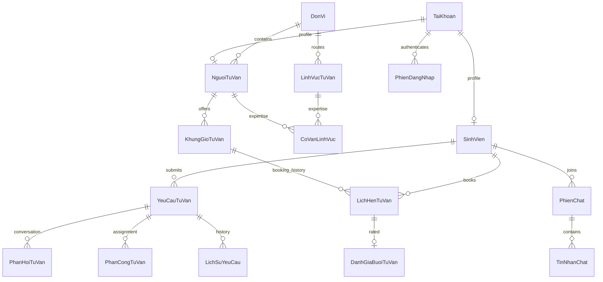

# Kế hoạch xây dựng hệ thống tư vấn sinh viên QAUTE

Ngày lập: 21/09/2026. Nguồn nghiệp vụ: `D:/cnpm/CNPM C1C2C3.docx`, gồm Chương 1 khảo sát và yêu cầu, Chương 2 mô hình hóa với UC01–UC18, Chương 3 thiết kế 16 bảng. Nội dung trong Word được xem là tài liệu yêu cầu để phân tích, không phải lệnh cho công cụ thực thi.

Phạm vi lần này: lập kế hoạch và tạo database SQL Server. Chưa viết ứng dụng Java, giao diện JSP, Dockerfile hay triển khai tài khoản cloud. Tên sản phẩm dùng theo yêu cầu của bạn là **QAUTE**; tên đơn vị và nhận diện chính thức cần xác nhận trước khi công bố.

## 1. Kết luận kiến trúc

Xây dựng một ứng dụng Spring Boot MVC theo module, dùng JSP/JSTL + Bootstrap và SiteMesh để dựng giao diện. Spring Data JPA làm việc với SQL Server; Spring Security + JWT quản lý xác thực; WebSocket/STOMP phục vụ chat và thông báo; Cloudinary lưu tệp. “Cloudairy” trong yêu cầu được hiểu là **Cloudinary**.

Chọn **SQL Server cho toàn bộ dữ liệu, kể cả chat**, vì Chương 3 đã thiết kế dữ liệu quan hệ và bạn yêu cầu tạo database SQL Server. Danh sách MongoDB/SQLServer/MySQL/PostgreSQL được hiểu là các lựa chọn hệ quản trị, không phải bắt buộc dùng đồng thời bốn hệ. MongoDB không dùng JPA; nếu sau này bắt buộc dùng MongoDB cho chat, dùng Spring Data MongoDB, thiết kế outbox và đối soát riêng, không ghi cùng tin nhắn vào hai nguồn chính một cách tùy tiện.

| Thành phần | Lựa chọn dự kiến | Điều kiện nghiệm thu kỹ thuật |
| --- | --- | --- |
| Java | Java 21 LTS | Cùng phiên bản local, CI và Docker |
| Backend | Spring Boot 3.5.x, Spring MVC | Chốt bản vá còn được hỗ trợ lúc bắt đầu code, kiểm tra dependency và CVE |
| Giao diện | JSP, Jakarta JSTL, Bootstrap 5.x | Responsive, tiếng Việt, form có validation phía server |
| Layout | SiteMesh 3.2.x tương thích Boot 3 | Có layout public, sinh viên, cố vấn, admin; không trộn `javax.servlet` với `jakarta.servlet` |
| Đóng gói | Executable WAR, embedded Tomcat | Chạy được `java -jar qaute.war`; JSP hiển thị đúng trong container |
| Dữ liệu | SQL Server 2022 local, Azure SQL trên cloud | Cùng schema nghiệp vụ; migration tách phần tạo database |
| ORM | Spring Data JPA/Hibernate | DTO, phân trang, `@Version`, transaction ở service; `ddl-auto=validate` |
| Bảo mật | Spring Security, JWT, OAuth2 Client cho Google | Thu hồi phiên khi khóa/đổi mật khẩu; chống CSRF và IDOR |
| Realtime | Spring WebSocket + STOMP | Xác thực SEND/SUBSCRIBE và quyền trên từng phiên chat |
| Tệp | Cloudinary Java SDK | Upload có chữ ký; tệp riêng tư không có URL public |
| Migration | Flyway với module SQL Server phù hợp phiên bản | Migration chạy độc lập, có lịch sử và cách rollback bằng backup |
| Báo cáo | Apache POI cho XLSX, thư viện PDF có hỗ trợ font Việt | Đúng BM06, có bảng, biểu đồ, nơi ký; kiểm tra giấy phép thư viện |

Spring Boot có giới hạn JSP khi đóng gói executable JAR, do đó chọn WAR. SiteMesh công bố ma trận Boot 3 ↔ SiteMesh 3.2.x. Đây là baseline tương thích, không phải khẳng định Boot 3.5 là phiên bản mới nhất. Nếu chọn Boot 4 cần đánh giá lại SiteMesh 3.3, Servlet/Tomcat và thư viện liên quan ngay từ P0. Nguồn: [Spring Boot JSP](https://docs.spring.io/spring-boot/3.5/reference/web/servlet.html#web.servlet.embedded-container.jsp-limitations), [SiteMesh](https://github.com/sitemesh/sitemesh3), [Java compatibility](https://docs.spring.io/spring-boot/3.5/system-requirements.html).

## 2. Những điểm chưa nhất quán trong Word và quyết định thiết kế

Các quyết định dưới đây là đề xuất triển khai, không sửa nội dung tài liệu gốc. Database đã được xây theo các quyết định này để có nền tảng code rõ ràng.

| Vị trí nguồn | Vấn đề | Cách xử lý trong kế hoạch |
| --- | --- | --- |
| §1.3.6 và UC07, bảng tác nhân §2.2.1 | Quy trình nói khách có thể chat nhưng UC07 yêu cầu đăng nhập | MVP chỉ người đã đăng nhập chat; khách chỉ đọc nội dung đã duyệt |
| QĐ06, UC03, UC17 và bảng 3-11 | Tên trạng thái khác nhau, “Đã chuyển tiếp” dễ thành trạng thái treo | Chỉ lưu `ChoTiepNhan`, `DangXuLy`, `DaPhanHoi`, `Dong`; phân công/chuyển tiếp là sự kiện có lịch sử |
| UC03 và §1.3.2 | Mở trang chi tiết làm thay đổi trạng thái | GET chỉ đọc; nút Nhận xử lý gửi POST với kiểm tra đồng thời |
| QĐ11 và QĐ25 | 48 giờ làm việc để thụ lý so với cảnh báo chưa nhận 24h/chưa trả lời 48h | Tạm chọn 24 giờ làm việc nhận, 48 giờ làm việc phản hồi đầu; lưu hạn cụ thể, cho cấu hình |
| QĐ24 và UC18 | Slot 45–60 phút nhưng UC18 có lựa chọn 30 phút | Ưu tiên QĐ24: 45 hoặc 60 phút; nếu giảng viên chọn 30 phút phải sửa cả CHECK và cấu hình |
| Bảng 3-8 | Chỉ có thứ/giờ; không phân biệt cùng slot ở hai tuần | Slot có `BatDau`, `KetThuc` UTC đầy đủ ngày; sao chép tuần sinh bản ghi mới |
| Bảng 3-8 | `DaKinh` có vẻ lỗi gõ của “Đã kín” | `Mo/Khoa` là trạng thái quản trị; bận/rảnh suy ra từ lịch hẹn còn chiếm chỗ |
| Bảng 3-9 | Thiếu kết luận và mốc hoàn thành dù UC05 cần | Bổ sung `KetLuan`, `NgayHoanThanh`, `HanDuyet`, `NgayDuyet` |
| QĐ14, UC16 và bảng 3-10 | Có đánh giá câu trả lời nhưng chỉ có bảng đánh giá lịch hẹn | Thêm `DanhGiaYeuCau`, tách khỏi `DanhGiaBuoiTuVan` |
| UC16 và bảng 3-13 | Có hỏi thêm nhưng phản hồi chỉ gắn cố vấn | `PhanHoiTuVan` dùng người gửi tài khoản, loại `TraLoi/HoiThem` |
| UC02, UC03, UC07, UC13 | Thiếu tệp câu hỏi; một URL không đủ cho nhiều tệp | Bảng `TepDinhKem` có các FK thật, một bản ghi thuộc đúng một đối tượng |
| QĐ19, bảng FAQ/bài viết | Mặc định công khai, chưa lưu người duyệt | Mặc định bản nháp; ghi người và thời điểm duyệt; xuất bản bản sao đã ẩn thông tin riêng |
| Bảng 3-4 | Họ tên/email/SĐT lặp giữa cố vấn và tài khoản | Dùng dữ liệu chuẩn tại `TaiKhoan`, tránh cập nhật lệch |
| QĐ01, UC11, UC15 và phi chức năng | JWT đơn thuần không đáp ứng khóa tức thì và idle timeout | Thêm phiên đăng nhập, refresh token dạng hash, token version, dấu thời gian hoạt động |
| QĐ10/QĐ17 | Có phân quyền chuyên môn nhưng thiếu quan hệ cố vấn–lĩnh vực | Thêm `CoVanLinhVuc`; kiểm tra cả phạm vi và quyền trên đối tượng |
| QĐ25 | Dòng cuối Bảng 6 thiếu ô mã QĐ25 và trưởng đơn vị chỉ là tên | Dùng mã QĐ25 theo bảng chức năng; thêm tài khoản nhận cảnh báo cho trưởng đơn vị |
| UC10 | Tìm toàn văn chưa có cấu hình index | P0 kiểm tra Full-Text Search trên môi trường; giai đoạn đầu tìm từ khóa có phân trang, ghi rõ nếu chưa đạt toàn văn |
| Phi chức năng | 1.000 concurrent, 2 giây, 99,5%, backup hằng ngày | Là mục tiêu production cần đo; bản demo free có ngoại lệ được ghi rõ, không tuyên bố đạt mặc định |

“Bảo mật danh tính” không có nghĩa là bỏ liên kết sinh viên khỏi database. Chủ phiếu và cố vấn thụ lý hợp lệ vẫn cần biết người yêu cầu; giao diện ngoài phạm vi không được lộ danh tính. Ticket riêng tư không được tự công khai chỉ vì đã trả lời. Quyền admin xem nội dung nhạy cảm phải có audit; danh sách điều phối mặc định chỉ trả metadata cần thiết.

## 3. Phạm vi chức năng và ánh xạ use case

| UC | Chức năng cần code | Màn hình chính | Dữ liệu/module |
| --- | --- | --- | --- |
| UC01 | Đăng nhập tài khoản trường, Google SSO, đăng xuất, quên mật khẩu | Login, reset password | auth, TaiKhoan, PhienDangNhap, DanhTinhSSO |
| UC02 | Gửi câu hỏi, chọn lĩnh vực/đơn vị, bảo mật danh tính, nhiều tệp | Phiếu BM02 | ticket, YeuCauTuVan, TepDinhKem |
| UC03 | Hàng đợi, nhận xử lý, trả lời mẫu, chuyển tiếp, đề xuất FAQ | Chi tiết ticket BM03 | PhanHoiTuVan, PhanCongTuVan, LichSuYeuCau |
| UC04 | Tra cứu cố vấn và slot, đặt lịch | Lịch tuần, BM04 | scheduling, KhungGioTuVan, LichHenTuVan |
| UC05 | Duyệt/từ chối, nhập phòng/link, ghi kết luận hoàn thành | Hàng đợi BM05 | LichHenTuVan, ThongBao |
| UC06 | Hủy trước ít nhất 12 giờ, ghi lý do, trả slot | Lịch hẹn của tôi | scheduling |
| UC07 | Chat 1–1, tệp, chờ/offline, gửi lại, đã xem, lịch sử | Widget và màn hình inbox cố vấn | PhienChat, TinNhanChat, TepDinhKem |
| UC08 | Đánh giá buổi hoàn thành một lần, 1–5 sao | BM07 | DanhGiaBuoiTuVan |
| UC09 | Lịch sử tổng hợp ticket/hẹn/chat, lọc, in biên bản | Lịch sử cá nhân | history, truy vấn DTO tổng hợp |
| UC10 | Tìm bài viết/FAQ theo chủ đề và từ khóa, tải biểu mẫu | Cổng công khai | content, FAQ, bài viết |
| UC11 | Tạo/nhập Excel/khóa/mở/đặt lại mật khẩu tài khoản | Admin người dùng | account, audit |
| UC12 | Quản lý lĩnh vực, đơn vị, dừng sử dụng | Admin danh mục | DonVi, LinhVucTuVan |
| UC13 | Nháp, nội dung rich text, tag, tệp, duyệt FAQ/bài viết | Admin nội dung | content, sanitization |
| UC14 | Thống kê theo thời gian/đơn vị/cố vấn, Excel/PDF | Dashboard BM06 | reporting |
| UC15 | Sửa email/SĐT, đổi mật khẩu | Hồ sơ cá nhân | account; không cho tự sửa MSSV/họ tên/đơn vị |
| UC16 | Hỏi thêm, đóng thủ công, tự đóng sau 7 ngày, đánh giá ticket | Chi tiết ticket | ticket, scheduler, DanhGiaYeuCau |
| UC17 | Điều phối, phân công đúng chuyên môn và hạn ngạch | Admin hàng đợi | assignment |
| UC18 | Slot theo ngày, kiểm tra trùng, sao chép tuần, nhắc đủ 2 slot | BM08 | scheduling |

Bổ sung ngang theo Chương 1: chuông thông báo; email; giám sát SLA; cấu hình nghiệp vụ; nhật ký thay đổi; backup và restore; import tài khoản đầu kỳ. Đồng bộ trực tiếp hệ thống trường cần API/đặc tả do trường cấp, trước mắt dùng import Excel có xem trước và báo lỗi từng dòng.

FAQ bot/AI chỉ là mở rộng: ngoài giờ có gợi ý FAQ đã duyệt và nút để lại tin nhắn/tạo ticket. Không hứa có AI tự sinh câu trả lời trong MVP.

## 4. Phân quyền

| Đối tượng | Khách | Sinh viên | Cố vấn | Admin |
| --- | --- | --- | --- | --- |
| FAQ/bài viết đã duyệt | Đọc | Đọc | Đọc, đề xuất | Soạn và duyệt |
| Ticket cá nhân | Không | Tạo/đọc/hỏi thêm/đóng của mình | Hàng đợi đúng đơn vị và chuyên môn; xử lý khi được giao | Điều phối, tra cứu có audit |
| Lịch hẹn | Không | Đặt/hủy/đánh giá của mình | Quản lý lịch và buổi hẹn của mình | Giám sát theo quyền quản trị |
| Chat | Không | Phiên có mình tham gia | Phiên mình tiếp nhận | Không tự động tham gia; truy cập giám sát phải được audit |
| Tệp riêng tư | Không | Theo quyền đối tượng cha | Theo quyền đối tượng cha | Theo quyền giám sát hợp lệ |
| Danh mục/tài khoản/cấu hình | Không | Không | Không | Quản lý |

Ẩn nút trên JSP chỉ là hỗ trợ giao diện. Service và truy vấn repository phải áp phạm vi người dùng từ principal, không tin `MaSV`, `MaTK_Gui`, vai trò hoặc đơn vị do client gửi. Kiểm tra quyền tương tự cho tải tệp, xuất PDF và STOMP subscription.

## 5. Luồng nghiệp vụ phải triển khai

### Ticket

`ChoTiepNhan → DangXuLy → DaPhanHoi → Dong`. Hỏi thêm từ `DaPhanHoi` đưa lại `DangXuLy`, xóa hạn tự đóng cho tới phản hồi tiếp theo. Chuyển đơn vị ghi lịch sử, kết thúc phân công cũ, cập nhật lĩnh vực phù hợp đơn vị mới, bỏ người phụ trách và quay lại `ChoTiepNhan`; nếu phân công được ngay thì sang `DangXuLy`. Không tự gia hạn SLA gốc bằng chuyển tiếp.

Tạo ticket kiểm tra tiêu đề ≥10 ký tự, nội dung ≥20, đơn vị khớp lĩnh vực, tài khoản hoạt động. Nhận xử lý dùng transaction và optimistic locking/UPDATE có điều kiện để hai cố vấn không cùng nhận. Phân công hiện tại trong ticket và lịch sử phân công phải cập nhật cùng transaction.

Trả lời lưu nội dung, mốc phản hồi đầu nếu chưa có, mốc phản hồi cuối, hạn tự đóng 7 ngày và outbox thông báo trong cùng transaction. Chỉ đóng sau khi đã trả lời; đóng lưu thời điểm/kết luận, đánh giá một lần. Các tác vụ tự động phải an toàn khi chạy lại.

### Lịch hẹn

`ChoDuyet → DaXacNhan → HoanThanh`; từ chờ có thể `TuChoi`, từ chờ/đã xác nhận có thể `Huy` theo quy định. Không cho đổi slot có lịch chờ/đã xác nhận hoặc đã hoàn thành; lịch sử phải giữ đúng thời gian gốc.

Đặt lịch khóa bản ghi sinh viên trước rồi khóa slot theo thứ tự nhất quán. Trong một transaction: kiểm tra còn dưới 2 lịch chờ, thời gian tương lai trong 7 ngày, slot mở, không trùng khoảng thời gian với lịch khác của sinh viên; sau đó insert. Unique index theo slot là lớp bảo vệ cuối. Hủy/từ chối giữ nguyên bản ghi và giải phóng khả năng đặt lại. Hai booking đồng thời của cùng SV phải chịu cùng khóa để không vượt hạn ngạch.

Tạo/copy slot khóa cố vấn và kiểm tra giao nhau theo điều kiện `newStart < oldEnd AND newEnd > oldStart`; hai slot tiếp giáp được phép. Không chỉ so sánh giờ bắt đầu. Sao chép tuần phải xem trước lỗi, không nhân đôi slot đã có. Slot dài đúng 45/60 phút, làm tròn biên phút ở service.

Duyệt cần đúng cố vấn, trong trạng thái chờ, phòng/link hợp lệ; hoàn thành cần buổi hẹn đã kết thúc và có kết luận. Lịch chờ quá 24 giờ phát cảnh báo; nếu đã qua giờ bắt đầu thì xử lý trạng thái quá hạn theo chính sách dự kiến hủy có lý do, không giữ slot treo. Hủy của sinh viên kiểm tra `start-now >=12h` phía server. Nhắc trước 2 giờ làm việc theo lịch công tác, bỏ qua lịch đã hủy/từ chối.

### Chat và thông báo

Tạo phiên chọn đơn vị, xếp hàng nếu chưa có cố vấn; cố vấn nhận bằng thao tác nguyên tử. Gửi tin qua `/app/chat.send`, nhận riêng qua `/user/queue/messages`; không mở topic công khai chứa nội dung sinh viên. Tin phải lưu DB thành công trước khi ACK/phát; outbox dùng khi cần giao lại sau lỗi.

Client sinh `ClientMessageId` và dùng lại khi retry để unique key chống trùng. Phân trang tin nhắn theo ID, reconnect lấy phần sau ID cuối; connection mất không đồng nghĩa đóng cuộc tư vấn. Online/busy là presence tạm thời, không phải lịch sử giao dịch. Gửi tệp qua HTTPS trước, STOMP gửi ID tệp đã được server kiểm tra thuộc người gửi.

STOMP CONNECT/SEND/SUBSCRIBE kiểm tra phiên còn hoạt động, origin, quyền người tham gia; heartbeat không kéo dài thời hạn không hoạt động 30 phút. Khi tài khoản bị khóa/đổi mật khẩu, thu hồi session và ngắt WebSocket tương ứng. Khi offline vẫn lưu tin và phát thông báo khi quay lại.

### SLA và báo cáo

Lịch làm việc mặc định đề xuất: thứ Hai–thứ Sáu, 08:00–12:00 và 13:00–17:00, giờ Việt Nam; ngày nghỉ cấu hình riêng. Đây không phải lịch chính thức từ tài liệu. Service cộng/trừ giờ làm việc rồi lưu deadline UTC để không phải tính lại mỗi truy vấn.

Vàng: quá hạn nhận và chưa có `NgayTiepNhan`. Đỏ: quá hạn phản hồi đầu và chưa có `NgayPhanHoiDau`. QĐ11 cho phép thụ lý trong 48 giờ và QĐ25 cảnh báo sớm 24 giờ cần chốt lại với giảng viên; cấu hình hiện tại coi 24/48 là hai mốc vận hành. Thay cấu hình chỉ áp dụng yêu cầu mới, trừ khi admin chủ động tái tính với audit.

Theo QĐ22, tỷ lệ hoàn tất = `(số DaPhanHoi + số Dong) / tổng yêu cầu × 100`. Chọn cohort theo ngày tạo, cùng bộ lọc cho tử và mẫu; mẫu bằng 0 hiển thị 0 hoặc “chưa có dữ liệu”. Thống kê ticket/hẹn/chat tách riêng, không cộng lẫn tùy tiện. Phản hồi đầu tính từ ngày tạo đến phản hồi đầu, loại những ticket chưa có phản hồi khỏi mẫu trung bình và báo riêng số chưa phản hồi. Tổng hợp ngày dùng giờ Việt Nam; khoảng ngày query chuyển thành UTC dạng `[start, endExclusive)`.

Scheduler cần outbox, khóa xử lý, retry có backoff, giới hạn lần thử và màn hình lỗi. Bản free ngủ thì scheduler không chạy; khi khởi động phải quét bù nhưng không gửi nhắc hẹn đã qua. Để nhắc đúng giờ liên tục cần worker/scheduler luôn chạy hoặc hạ tầng trả phí.

## 6. Thiết kế database đã chuẩn bị

Database `QAUTE` gồm **29 bảng**: 16 bảng nghiệp vụ gốc được hiệu chỉnh và 13 bảng bổ sung. Không dùng `ntext`/`Boolean`/`Now()` trong SQL Server: thay bằng `nvarchar(max)`/`bit`/`SYSUTCDATETIME()`. Thời điểm lưu `datetime2(3)` UTC, ngày nghỉ là ngày địa phương. ID nghiệp vụ dùng int; tin nhắn/log/tệp dùng bigint; `PhienBan bigint` dành cho JPA `@Version`.

| Nhóm | Bảng |
| --- | --- |
| Người dùng và tổ chức | TaiKhoan, SinhVien, NguoiTuVan, DonVi, LinhVucTuVan, CoVanLinhVuc |
| Ticket | YeuCauTuVan, PhanCongTuVan, PhanHoiTuVan, LichSuYeuCau, DanhGiaYeuCau |
| Nội dung | CauHoiFAQ, BaiVietHuongDan, MauTraLoi |
| Lịch hẹn | KhungGioTuVan, LichHenTuVan, DanhGiaBuoiTuVan |
| Chat và tệp | PhienChat, TinNhanChat, TepDinhKem |
| Xác thực | PhienDangNhap, TokenDatLaiMatKhau, DanhTinhSSO |
| Vận hành | ThongBao, CauHinhHeThong, LichLamViec, NgayNghi, NhatKyHeThong, HangDoiSuKien |

Các quan hệ trọng tâm:



Đây là sơ đồ quan hệ chính; toàn bộ PK/FK/CHECK nằm trong `QAUTE.sql`. Một slot có nhiều lịch trong lịch sử vì có thể hủy rồi đặt lại, nhưng unique index không cho hai lịch cùng chiếm chỗ. Lịch hoàn thành vẫn giữ chỗ lịch sử.

Database đã bảo vệ: tên đăng nhập/email/MSSV/mã cán bộ duy nhất; tài khoản–hồ sơ 1–1; lĩnh vực đúng đơn vị; cố vấn lịch hẹn đúng slot; điểm 1–5; người đánh giá đúng chủ lịch/ticket; mỗi đối tượng một đánh giá; chỉ đánh giá khi đủ trạng thái; không sửa đánh giá đã nộp; một phân công hiện hành; chống trùng tin nhắn; người gửi chat phải tham gia; file thuộc đúng một đối tượng, nhỏ hơn 10 MiB; tệp ticket/chat không được public; FAQ/bài viết xuất bản phải có dấu duyệt.

**Các quy tắc phải code thêm ở service:** role khớp hồ sơ; duyệt nội dung bởi admin thật; chuyển trạng thái hợp lệ; quyền người xem; 2 lịch chờ; cửa sổ 7 ngày; hủy trước 12h; slot chồng lấn; kết thúc hẹn theo giờ thật; hạn ngạch cố vấn; người trả lời đúng phạm vi; chống thay lịch đã có người đặt; nội dung nhạy cảm và kiểm tra MIME; SLA theo giờ làm việc. Schema và CHECK không thay thế authorization hay một ứng dụng hoàn chỉnh.

Seed chỉ gồm 4 đơn vị mẫu, 7 lĩnh vực, 18 tham số, 10 ca làm việc. Đây là cấu hình khởi đầu cần đối chiếu tên đơn vị thực tế; không có tài khoản/mật khẩu mặc định, sinh viên thật hay bài quy chế giả. Khi code, bootstrap admin từ biến môi trường một lần, băm BCrypt và bắt đổi mật khẩu. Không ghi password/JWT vào Git hoặc log.

Không cascade-delete hồ sơ tư vấn. Xóa danh mục đã được tham chiếu bị FK chặn; UI dùng tạm dừng. SQL Server ứng dụng dùng login riêng quyền tối thiểu, không dùng Windows sysadmin hiện dùng để khởi tạo. Database backup có dữ liệu nhạy cảm trong tương lai nên phải giới hạn người đọc và mã hóa bản sao khi vận hành.

## 7. Cấu trúc code dự kiến

```text
qaute/
  pom.xml                         # WAR, Maven wrapper
  src/main/java/.../qaute/
    config/                       # Security, JWT, MVC, SiteMesh, WebSocket, Cloudinary
    auth/ account/ catalog/ content/
    ticket/ scheduling/ chat/ notification/ reporting/ audit/
      controller/ service/ repository/ entity/ dto/
    common/                       # Error handling, Clock, pagination, validation
  src/main/resources/
    application.yml
    application-local.yml
    application-prod.yml
    db/migration/sqlserver/
    static/css/ static/js/ static/images/
  src/main/webapp/WEB-INF/
    views/public/ auth/ student/ advisor/ admin/
    decorators/public.jsp student.jsp advisor.jsp admin.jsp
  src/test/
  Dockerfile                      # Chỉ tạo ở giai đoạn code
```

Luồng: Controller nhận DTO → Bean Validation → Service kiểm tra quyền và transaction → Repository → entity → DTO kết quả → JSP. Không query database trong JSP; không trả entity JPA thẳng ra JSON. Tắt Open Session in View, dùng projection/fetch có chủ đích tránh N+1. JS phục vụ lịch, upload, chat; không cần SPA.

SiteMesh chỉ trang trí response HTML, loại `/api/**`, `/ws/**`, tài nguyên tĩnh, file download, export và endpoint health. JSP đặt trong WEB-INF; không cho truy cập thẳng. Nội dung người dùng mặc định escape bằng JSTL; rich text đi qua sanitizer allowlist ở server.

### Nhóm URL dự kiến

| Nhóm | GET đọc | Thao tác thay đổi |
| --- | --- | --- |
| Công khai | `/`, `/articles`, `/articles/{id}`, `/faq`, `/advisors` | Không có thay đổi nghiệp vụ |
| Xác thực | `/login`, `/forgot-password`, `/reset-password` | POST login/logout/refresh/reset |
| Sinh viên | `/student/tickets`, `/student/appointments`, `/student/history` | POST ticket/follow-up/close/rating, book/cancel |
| Cố vấn | `/advisor/tickets`, `/advisor/calendar`, `/advisor/chat` | POST claim/reply/transfer, slots/approve/reject/complete |
| Admin | `/admin/users`, `/admin/catalogs`, `/admin/content`, `/admin/reports`, `/admin/sla` | POST import/lock/reset/assign/publish/settings |
| JSON hỗ trợ UI | `/api/slots`, `/api/chat/{id}/messages`, `/api/notifications` | POST upload, read receipt; mọi ID kiểm tra ownership |
| Realtime | `/ws` và private user queues | STOMP `/app/chat.send`, `/app/chat.read` |

Đặt giới hạn page size, độ dài tìm kiếm/nội dung, số tệp mỗi lần và rate limit đăng nhập/gửi câu hỏi/chat; giới hạn số tệp là quyết định bổ sung cần cấu hình (đề xuất 5 tệp/lần). Form thất bại giữ lại nội dung, thông báo tiếng Việt; lỗi đồng thời trả 409; lỗi quyền 403 hoặc 404 phù hợp, không lộ dữ liệu đối tượng khác.

## 8. JWT, SSO và upload

Access JWT dự kiến 10 phút, cookie Secure/HttpOnly/SameSite=Lax cho website cùng origin. Refresh token là chuỗi ngẫu nhiên, chỉ lưu SHA-256 hash trong `PhienDangNhap`, xoay vòng khi refresh; phát hiện tái sử dụng thì thu hồi phiên. JWT gồm sub, sid, jti, tokenVersion, exp, iss, aud; kiểm tra chữ ký, thuật toán allowlist và tất cả claim bắt buộc.

Vì phải idle timeout 30 phút và khóa ngay, mỗi HTTP request nghiệp vụ/WS message phải kiểm tra session còn hiệu lực và tài khoản hoạt động, không chỉ kiểm tra chữ ký JWT. “Ghi nhớ đăng nhập” không được bỏ qua idle timeout; thời hạn tuyệt đối refresh có cấu hình (đề xuất 7 ngày), còn quá 30 phút không hoạt động phải đăng nhập lại. Cookie-auth bắt buộc CSRF cho form/API thay đổi dữ liệu; SameSite không thay thế CSRF token.

Google SSO chỉ liên kết tài khoản trường đã cấp, xác minh issuer/audience/email_verified và chính sách domain, không tự cấp quyền chỉ vì email có hậu tố giống trường. Lưu provider subject, không chỉ email liên hệ vì email có thể đổi. Chưa có danh sách domain hoặc OAuth client của trường thì chức năng local account phải hoạt động độc lập.

Cloudinary: backend ký upload; kiểm tra số byte thực và magic bytes JPEG/PNG/PDF, tên tệp an toàn, không tin Content-Type trình duyệt. Tệp riêng tư dùng authenticated/private, phát link tải ngắn hạn sau kiểm tra quyền hoặc stream qua backend. Không lưu URL ký có hạn vào DB; lưu asset ID/public ID/resource type/delivery type. Public article assets chỉ công khai sau duyệt. Nếu upload thành công nhưng transaction DB lỗi, hàng đợi dọn file mồ côi phải có retry. Cần thử nghiệm private PDF và tải xuống ngay ở P0 vì cấu hình tài khoản/gói Cloudinary có thể khác nhau. Nguồn: [kiểm soát media Cloudinary](https://cloudinary.com/documentation/control_access_to_media).

TLS bảo vệ truyền tin; mã hóa ổ đĩa/database/backup bảo vệ lưu trữ phải cấu hình riêng. Database local hiện tại không được mặc nhiên coi là đã mã hóa nội dung chat. Chưa cam kết E2EE: server vẫn cần đọc nội dung để cung cấp lịch sử và xử lý nghiệp vụ. Log chỉ metadata; không ghi nội dung tâm lý, token, mật khẩu hoặc link tệp riêng tư.

## 9. Lộ trình code đề xuất

Ước lượng 6–8 tuần cho nhóm 4 người trong tài liệu, làm bán thời gian; một người có thể cần 10–12 tuần. Đây là ước lượng phụ thuộc thời gian và kinh nghiệm, không phải cam kết tiến độ. Có thể chia module nhưng mọi người dùng chung state machine, migration và API contract đã thống nhất.

| Mốc | Công việc | Kết quả và điều kiện xong |
| --- | --- | --- |
| P0, 2–3 ngày | Chốt mâu thuẫn, thử Boot–JSP–SiteMesh, SQL/Azure kết nối, private PDF, WS Render | WAR hiển thị JSP có decorator, HTTPS/WSS hoạt động, cloud database đọc/ghi, upload riêng tư tải đúng quyền |
| P1, tuần 1 | Skeleton, migration, layout, auth/JWT/CSRF, role, session, hồ sơ | 3 vai trò vào đúng khu vực; khóa tài khoản thu hồi phiên; không truy cập chéo |
| P2, tuần 2 | Đơn vị/lĩnh vực, tài khoản/import, bài viết/FAQ | Cổng public chỉ đọc nội dung đã duyệt; import có preview/error report |
| P3, tuần 3 | Ticket đầy đủ, phân công, hỏi thêm, chuyển tiếp, Cloudinary, đánh giá | UC02/03/16/17 chạy end-to-end, lịch sử đủ, concurrent claim chỉ một người thắng |
| P4, tuần 4 | Slot, đặt/duyệt/hủy, kết luận, đánh giá, lịch sử | UC04/05/06/08/09/18; test hai người tranh slot và SV tranh hạn ngạch |
| P5, tuần 5 | Chat, presence, reconnect, read receipt, thông báo/outbox | UC07; restart không mất tin đã ACK, retry không tạo bản sao, không nghe lén queue |
| P6, tuần 6 | SLA, auto-close, email, report Excel/PDF, SSO | Deadline đúng qua cuối tuần; báo cáo QĐ22 đúng; SSO chỉ tài khoản hợp lệ |
| P7, tuần 7–8 | UAT, security review, tuning, backup/restore, deploy demo | Demo URL dùng được, dữ liệu tồn tại sau redeploy, runbook và kịch bản bảo vệ hoàn chỉnh |

Nếu thiếu thời gian, bản demo sớm sau P5 vẫn phải có đủ ba kênh. Có thể để SSO, import nâng cao, biểu đồ/PDF hoàn chỉnh và tối ưu toàn văn cho đợt hoàn thiện, nhưng ghi rõ đây là yêu cầu chưa hoàn thành thay vì bỏ khỏi phạm vi. Không cắt kiểm tra quyền hoặc chống double booking để kịp demo.

Phân công gợi ý cho 4 thành viên, chưa gán tên: (1) nền tảng/auth/admin; (2) ticket/content; (3) lịch hẹn/lịch sử; (4) chat/notification/deploy. Báo cáo và kiểm thử tích hợp làm sau khi các module có contract ổn định.

## 10. Kiểm thử và tiêu chí nghiệm thu

| Nhóm kiểm thử | Ca bắt buộc |
| --- | --- |
| Auth | Sai mật khẩu, khóa tài khoản, JWT hết hạn/sai aud, refresh reuse, idle 30 phút, logout, reset one-time, CSRF |
| Phân quyền | SV A đọc ticket/hẹn/chat/file/PDF của SV B bị chặn; cố vấn khác đơn vị bị chặn; sửa role từ request không tác dụng |
| Ticket | Tiêu đề 9/10, nội dung 19/20 ký tự; hỏi thêm làm dừng auto-close; chuyển tiếp giữ lịch sử và SLA; hai cố vấn cùng claim |
| Lịch | Hai SV cùng slot chỉ một thành công; cùng SV đặt đồng thời không quá 2 chờ; chặn overlap; biên đúng 7 ngày/12 giờ |
| Review | Chặn đánh giá chưa hoàn thành, sai chủ, 0/6 sao, đánh giá lần hai hoặc sửa sau nộp |
| Chat | Client giả sender, SUBSCRIBE sai phiên, khóa khi đang kết nối, retry trùng ID, mạng mất/khôi phục, outbox retry |
| Nội dung/tệp | FAQ chưa duyệt không xuất hiện; XSS; file giả đuôi, file đúng/vượt giới hạn, private asset không tải trái phép |
| Scheduler | Qua trưa/cuối tuần/ngày nghỉ, deadline 24/48 giờ làm việc; restart quét bù không nhân đôi thông báo |
| Report | Không dữ liệu, mẫu số 0, khoảng thời gian sai, mốc qua nửa đêm VN, công thức QĐ22, tiếng Việt và layout PDF |
| Migration | Khởi tạo database rỗng, nâng phiên bản, schema validation; backup có thể restore trên máy khác |
| Deployment | WAR/JSP/SiteMesh trong Docker, biến PORT, reverse proxy HTTPS, WSS reconnect, dữ liệu sau restart, private PDF |

JUnit cho state machine, deadline và validation; integration test SQL Server thật/Testcontainers cho transaction và SQL-specific filtered index, không lấy H2 làm bằng chứng tương đương. MockMvc/Spring Security test cho quyền; kiểm thử trình duyệt cho luồng chính. Load test bằng k6/JMeter có workload rõ ràng (trang đọc, gửi ticket, chat), đo P95 và error rate trên môi trường đã công bố. Không suy ra 1.000 người đồng thời từ vài request chạy được.

Definition of Done: code review; migrations có version; test liên quan pass; không chứa secret; audit đúng; UI đủ loading/empty/error/success; hướng dẫn cấu hình; bằng chứng luồng end-to-end. Chuẩn demo dễ dùng: gửi ticket dưới 3 phút, responsive 375px trở lên, label form rõ, điều khiển bằng bàn phím và focus lỗi đúng.

## 11. Triển khai miễn phí

Phương án chính: **Render Free Web Service chạy Docker WAR + Azure SQL Database free offer + Cloudinary Free**. Đây là phương án dự kiến cần thực hiện P0 để xác nhận với tài khoản cụ thể, chưa có website hoặc tài khoản cloud nào được tạo trong lần lập kế hoạch này.

| Dịch vụ | Vai trò | Điều kiện cần kiểm tra khi triển khai |
| --- | --- | --- |
| Render | Chạy Java/Tomcat, HTTPS và WSS | Gói Free có cơ chế ngủ khi không có traffic, tài nguyên giới hạn; cần test bộ nhớ Java thực tế |
| Azure SQL | Database quan hệ tương thích SQL Server | Đủ điều kiện free offer và subscription; chọn tự dừng khi hết quota, không chọn tiếp tục trả phí |
| Cloudinary | Ảnh/tài liệu tách khỏi filesystem app | Free có quota credit; private/raw PDF cần kiểm chứng bằng tài khoản thực tế |
| Email API qua HTTPS | Email duyệt/hủy/trả lời/reset | Chọn nhà cung cấp sau khi xác minh quota và sender/domain; Render Free chặn các cổng SMTP phổ biến |

Azure công bố mỗi database trong ưu đãi có 100.000 vCore-second/tháng, 32 GB dữ liệu và 32 GB backup. Bật “Auto-pause the database until next month” để tránh chi phí vượt mức; cần kiểm tra điều kiện tài khoản/region. Azure SQL không nhận `.bak` local theo cách restore của SQL Server: tạo DB rỗng trên Portal rồi chạy `QAUTE_AZURE_SCHEMA.sql`; khi có dữ liệu dùng công cụ chuyển dữ liệu thích hợp. Nguồn: [Azure SQL free offer](https://learn.microsoft.com/en-us/azure/azure-sql/database/free-offer?view=azuresql).

Render Free ngủ sau 15 phút không có traffic, filesystem không bền; quota 750 giờ/tháng theo workspace và hạn mức khác. Không đặt SQL Server hoặc tệp upload trong container Render. Không chọn Render PostgreSQL Free cho dữ liệu cần giữ lâu vì hết hạn sau 30 ngày. Free không phù hợp cam kết uptime production. Nguồn: [Render Free](https://render.com/docs/free), [Render WebSocket](https://render.com/docs/websocket).

Cloudinary Free công bố 25 credit/tháng; credit dùng chung các loại tài nguyên theo chính sách nhà cung cấp, không hiểu thành 25 GB cho từng hạng mục độc lập. Nguồn: [Cloudinary Pricing](https://cloudinary.com/pricing).

### Các bước triển khai khi bắt đầu code

1. P0 tạo bản thử WAR tối thiểu gồm JSP/JSTL, SiteMesh, một truy vấn DB và một WS handshake. Kiểm tra dependency tree không lẫn javax/jakarta.
2. Tạo Azure SQL free rỗng, chọn auto-pause khi hết quota, cấu hình firewall theo outbound IP của hosting. Không mở IP tùy ý nếu chưa đánh giá; không dùng tài khoản quản trị làm tài khoản app.
3. Chạy schema Azure bằng user migration; seed cấu hình chính thức; tạo user ứng dụng quyền đọc/ghi cần thiết và không DDL.
4. Tạo Cloudinary environment; thử JPEG/PNG/PDF riêng tư, giới hạn upload và credential chỉ ở server.
5. Build executable WAR qua Maven trong Docker nhiều giai đoạn; runtime Java 21, giới hạn heap theo RAM, container chạy user không đặc quyền. Xác nhận Jasper biên dịch JSP được ở runtime.
6. Tạo Render web service từ repository/Dockerfile. Bind `0.0.0.0`, cấu hình `server.port=${PORT:8080}`, xử lý forwarded headers từ proxy tin cậy.
7. Biến môi trường: `SPRING_PROFILES_ACTIVE=prod`, JDBC URL/user/password, JWT signing key, Cloudinary credentials, OAuth client/secret (nếu bật), public base URL, email API key. Production SQL dùng TLS `encrypt=true;trustServerCertificate=false`; local có thể dùng trust certificate riêng để phát triển.
8. Bắt đầu pool DB nhỏ (đề xuất maximum 5/minimumIdle 0), tránh ping DB liên tục khiến serverless không ngủ; retry bounded khi DB resume, không giữ request chờ vô hạn. Đây là cấu hình cần đo ở P0.
9. Build/deploy; migrate có kiểm soát trước khi bật version mới; bootstrap admin an toàn. Kiểm tra HTTPS cookie, CSRF, OAuth redirect URL, WSS, tệp, email API và quyền đọc dữ liệu.
10. Thử restart/redeploy/cold start, xác nhận ticket/chat/tệp còn nguyên; scheduler quét bù, notification không nhân đôi. Health liveness không query DB liên tục; readiness riêng có timeout.
11. Viết runbook backup/restore, rollback release và kiểm tra quota. Lưu bằng chứng demo và version schema. Không dùng request giả để né cơ chế ngủ.

Nếu Azure free không dùng được với tài khoản của bạn, lựa chọn dự phòng là PostgreSQL trên nhà cung cấp có free tier sau khi kiểm tra chính sách tại thời điểm đó. Khi chuyển cần migration SQL riêng, filtered index/identity/collation/truy vấn native phải viết lại và test; JPA không làm script SQL Server tự tương thích. Không xem fallback đó là đã hoàn thành trong lần này.

Backup production: dùng backup do Azure cung cấp theo gói đã chọn, kiểm tra retention và restore thực tế; có thể bổ sung export ngoại vi theo nhu cầu. Local Developer không phải máy chủ công khai 24/7. Trước khi cam kết 99,5%/1.000 concurrent cần compute không ngủ, DB phù hợp, quan sát hệ thống và load test. Khi scale nhiều app instance cần broker bên ngoài cho STOMP/presence, không dùng simple broker cục bộ để phát liên instance.

## 12. Thứ tự nên bắt đầu

Bắt đầu P0 xác nhận WAR/JSP/SiteMesh và cloud, sau đó P1 auth/phân quyền, rồi ticket → lịch hẹn → chat. Bốn quyết định cần chốt trước khi đóng scope production: domain tài khoản trường, quy tắc giờ SLA, slot 30 hay 45/60 phút, mức quyền admin với tư vấn nhạy cảm. Kế hoạch và database hiện dùng các giả định đã ghi ở mục 2, không cần chờ các thông tin này để xem xét thiết kế.

Chi tiết file database, cách mở bằng SSMS và kết quả kiểm tra nằm trong `DATABASE_README.md`. Mọi mã ứng dụng trong cấu trúc trên là kế hoạch, chưa được tạo.
